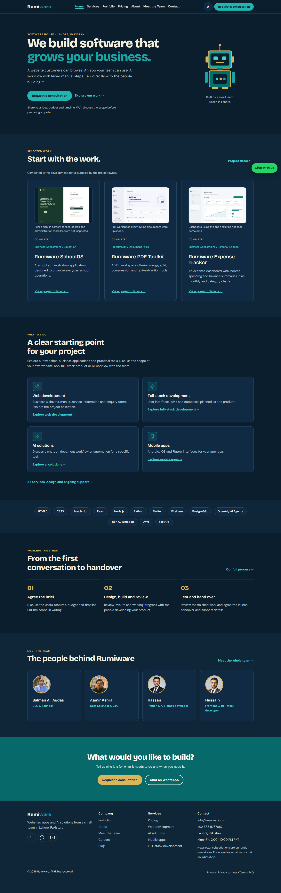

# Rumiware

### Websites, business applications, and practical AI solutions

The company website and project portfolio for **Rumiware**, a software house based in Lahore, Pakistan. Explore services, meet the team, browse working project demos, and request a consultation.

**[View the live website](https://salmanaliaqdas.github.io/rumiware.com/)** · **[Explore the portfolio](https://salmanaliaqdas.github.io/rumiware.com/portfolio.html)** · **[Contact Rumiware](mailto:info@rumiware.com)**



## About this repository

This repository contains the Rumiware company website. The applications featured in its portfolio are hosted separately and linked from the site.

The website uses HTML, CSS, and vanilla JavaScript, with a lightweight Node.js build script that generates complete static pages from shared templates and structured content.

## Website features

- Responsive layouts with dark and light themes.
- A project portfolio with category filters and authentic application previews.
- Service pages, pricing information, team profiles, and FAQs.
- A multi-step project enquiry form with validation and a final review.
- Contact options through email, phone, and WhatsApp.
- Keyboard navigation, visible focus indicators, and reduced-motion support.
- Page-specific metadata, social-sharing images, a sitemap, and a custom 404 page.
- Automated HTML, link, asset, accessibility, and browser regression checks.

## Featured projects

| Project | Purpose | Demo |
| --- | --- | --- |
| Rumiware SchoolOS | School administration application | [Open SchoolOS](https://rumiware-schoolos.vercel.app/) |
| Rumi Enquiry Assistant | Enquiry classification, clarification, and draft-review demonstration | [Explore demo](https://rumi-portfolio-demo.vercel.app/) |
| Rumiware Stock Market App | Stock research and company-information dashboard | [Open app](https://rumiware-stock-market.streamlit.app/) |
| Rumiware PDF Toolkit | PDF document tools in one workspace | [Open toolkit](https://rumiware-pdf-toolkit.streamlit.app/) |
| Python 2D Platformer | Platform-game project with a browser demonstration | [Play demo](https://salmanaliaqdas.github.io/python-2d-game-super-mario/) |
| Rumiware Weather App | Location-based weather conditions and forecasts | [Open app](https://rumiware-weather-app.streamlit.app/) |
| Rumiware Expense Tracker | Expense summaries and spending visualizations | [Open app](https://rumiware-expense-tracker.streamlit.app/) |
| Rumiware QR Code Studio | Website QR-code generation and export | [Open studio](https://rumiware-qr-code-studio.streamlit.app/) |
| Rumiware Movies | Movie discovery and catalogue browsing | [Open app](https://rumiware-movies.streamlit.app/) |

## Technology

| Area | Technology |
| --- | --- |
| Frontend | HTML5, CSS3, vanilla JavaScript |
| Static build | Node.js and JSON content files |
| Browser tests | Playwright |
| Accessibility checks | axe-core |
| HTML validation | html-validate |
| Continuous integration and hosting | GitHub Actions and GitHub Pages |

## Local development

Requires **Node.js 24 or newer** and npm.

```bash
git clone https://github.com/SalmanAliAqdas/rumiware.com.git
cd rumiware.com
npm ci
npm run preview
```

The preview command builds the site and starts the local server:

- Root preview: http://127.0.0.1:4174/
- Repository-path preview: http://127.0.0.1:4174/rumiware.com/

After changing source files, run `npm run build` and refresh the page. In Windows PowerShell, `npm.cmd` can be used in place of `npm` if script execution is restricted.

## Project structure

```text
src/
  layout/       Shared document, header, and footer templates
  pages/        Page content
  assets/       Styles, scripts, and brand illustration
  data/         Projects, services, team, pricing, and site configuration
images/         Project previews, portraits, fonts, and sharing images
scripts/        Build, preview, validation, and asset tools
tests/          Browser regression tests
docs/           Maintenance documentation
verification/   QA reports and supporting evidence
reference/      Archived source and original captures
dist/           Generated website; excluded from Git
```

Content is maintained in `src/`. The build generates `dist/`; generated pages should not be edited directly. See the [maintenance guide](docs/MAINTENANCE.md) for content locations and hosting details.

## Validation and tests

```bash
npm run build
npm run check
npx playwright install chromium
npm test
```

On Linux environments that need browser system dependencies, use `npx playwright install --with-deps chromium`. On Windows, browser tests use installed Chrome by default; `CHROME_PATH` can select another compatible executable.

Static checks cover generated HTML, internal links, anchors, assets, metadata, and release exclusions. Browser tests cover navigation, themes, responsive layouts, forms, project filters, and accessibility. Form submissions are mocked during testing.

## Deployment

Pushes to `main` trigger the GitHub Pages workflow, which builds and validates the website and publishes **only `dist/`**. The workflow accounts for the repository's existing legacy Pages publisher before deploying the built site.

The live Pages site is available at **https://salmanaliaqdas.github.io/rumiware.com/**.

External hosting uses the contents of `dist/` through a separate upload process. GitHub Pages deployment does not update Hostinger or change domain settings.

The [Hostinger workflow and recovery guide](docs/HOSTINGER.md) describes
automatic deployment on pushes to `main`, manual `workflow_dispatch` deployment,
required secrets, destination and hosting configuration safeguards, full backups,
and restore procedure.

## Contact

**Rumiware · Lahore, Pakistan**  
Email: [info@rumiware.com](mailto:info@rumiware.com)  
WhatsApp: [Chat with Rumiware](https://wa.me/923335767687)

## Licenses and attribution

The repository currently has no project-wide open-source license. Bundled fonts retain their respective licenses in [images/fonts](images/fonts/).
